---
title: "Análisis de la demanda de pasajeros (2017–2026)"
subtitle: "Análisis de series temporales y pronóstico"
format:
  html:
    embed-resources: true
---

## 1. Introducción

Este informe presenta el análisis de la serie mensual de pasajeros y despachos entre 2017 y 2026.

## 2. Evolución de la serie

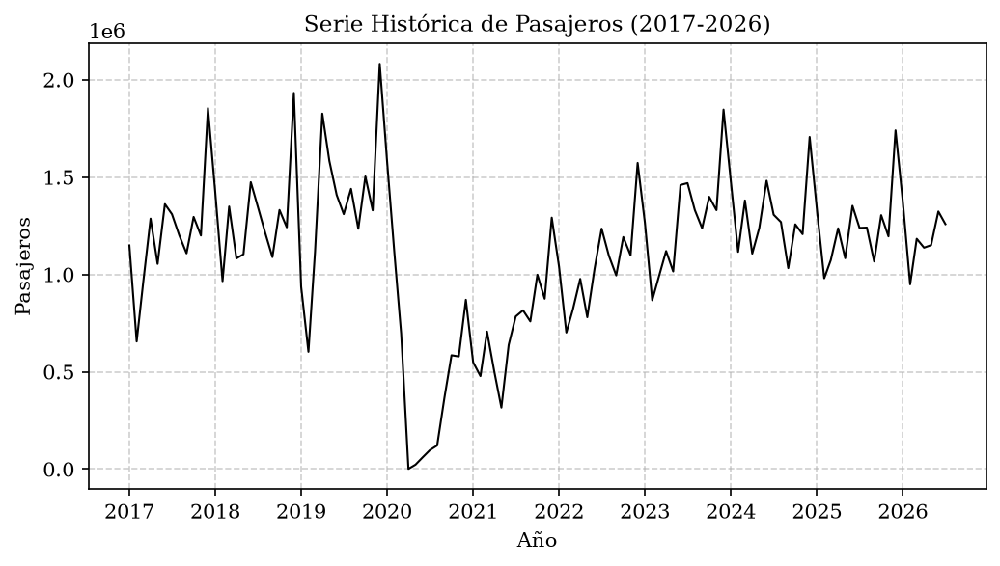

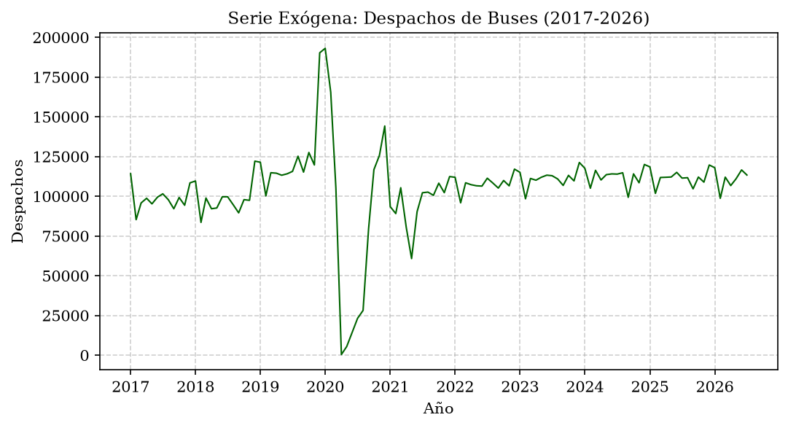

## 3. Exploración de los datos

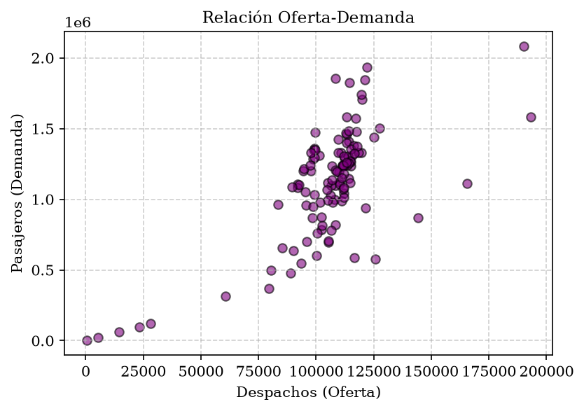

## 4. Identificación y diagnóstico del modelo

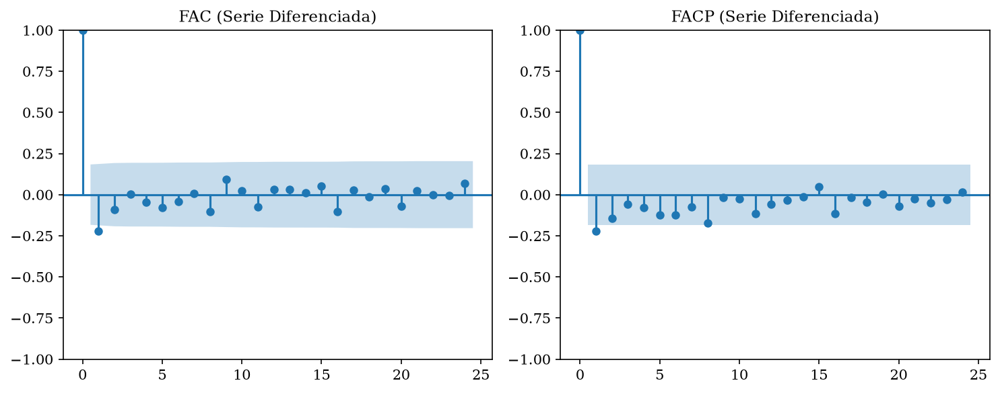

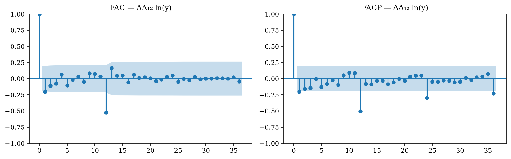

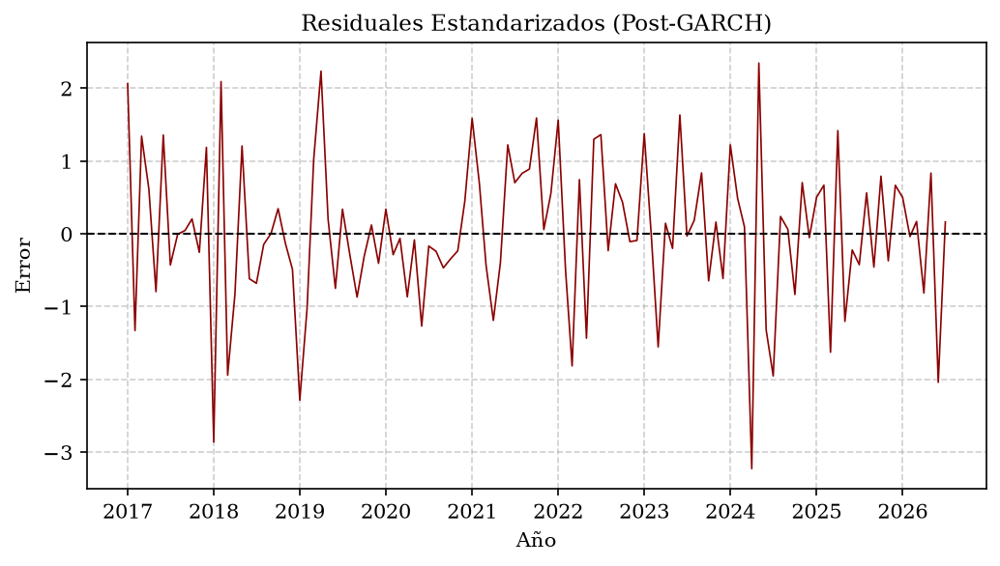

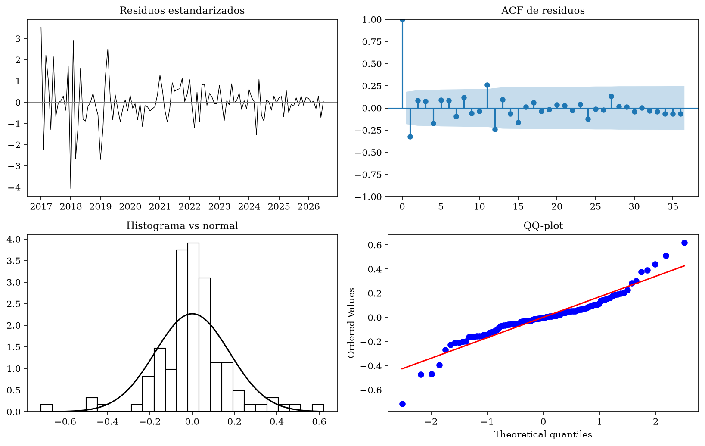

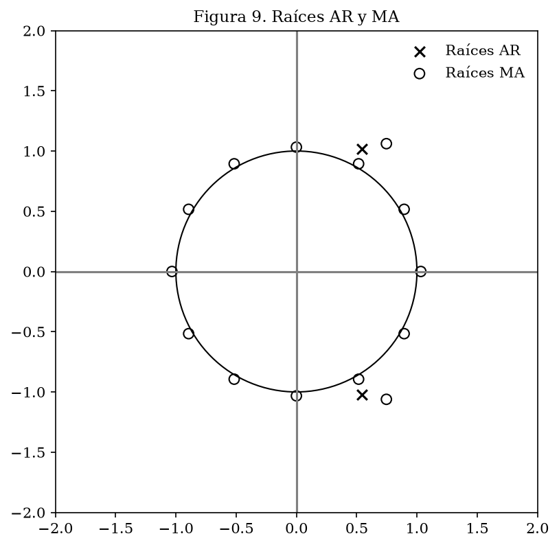

## 5. Pronóstico y evaluación

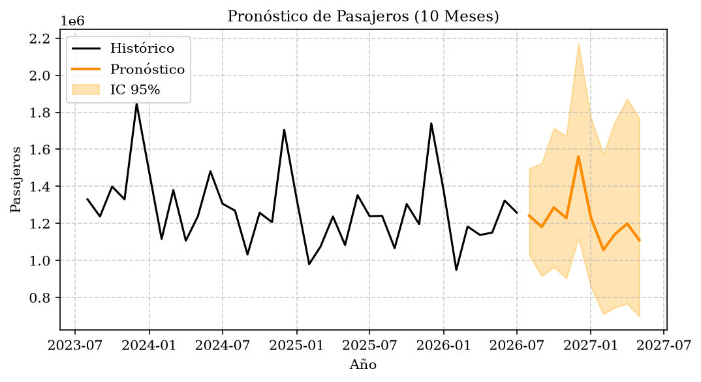

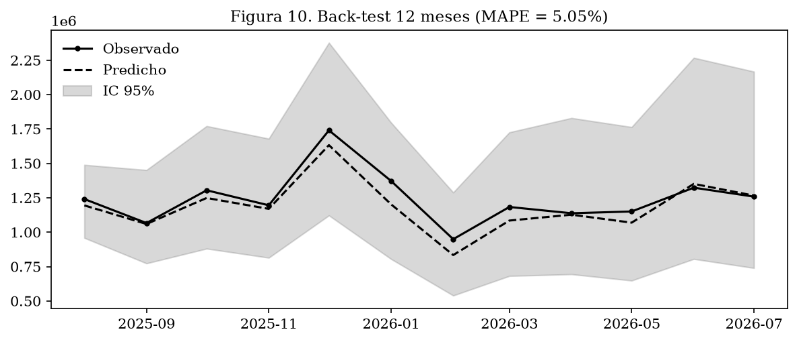

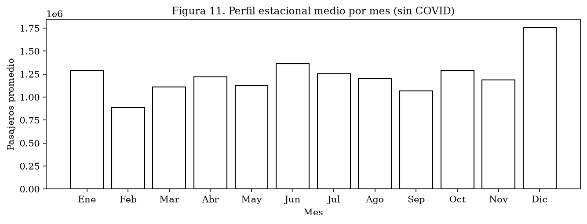

## 6. Tablas de resultados

### Coeficientes

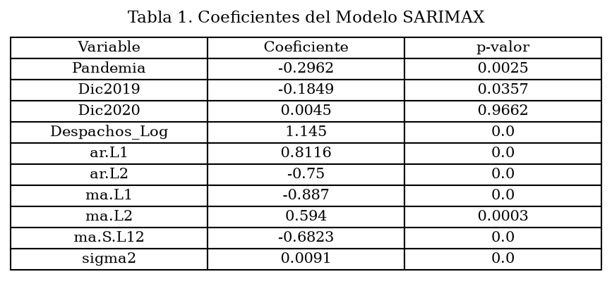

### Pruebas diagnósticas

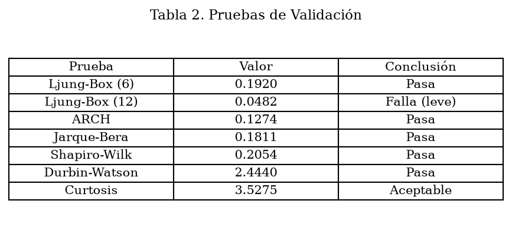

### Pruebas de estacionariedad

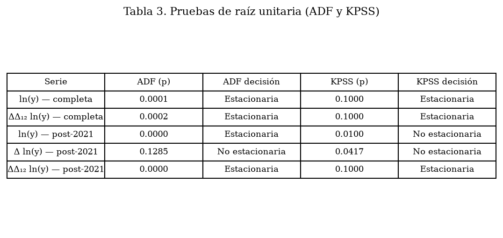

### Modelos candidatos

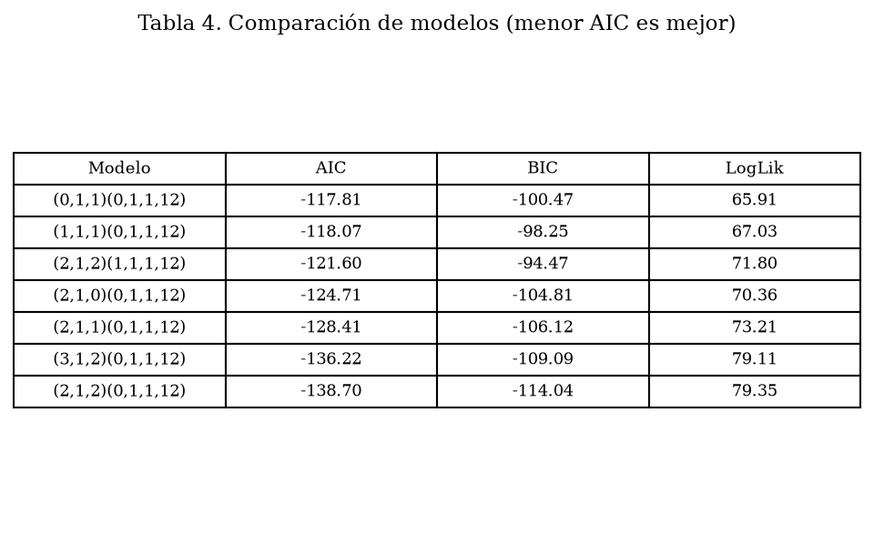
